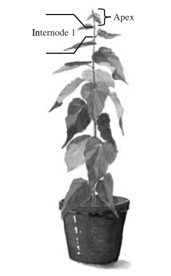

```{r setup, include=FALSE}
library(learnr)
# pcaMethods is loaded first on purpose: it masks a few base/stats functions,
# and loading the tidyverse packages afterwards restores the ones we need.
library(pcaMethods)
library(ggplot2)
library(dplyr)
library(tidyr)
library(plotly)
library(knitr)
library(DT)
library(readxl)
library(mixOmics)
library(pls)

# mixOmics and pcaMethods BOTH export a function called pca(), and mixOmics is
# loaded last, so a bare pca() would be the mixOmics one. Throughout this
# tutorial we therefore write pcaMethods::pca() and mixOmics::plsda() in full.

tutorial_options(exercise.timelimit = 120)

# ---- Load the real data -----------------------------------------------------
raw <- suppressMessages(
  read_excel("metabolomics.xlsx", sheet = 1)
)

# Column 1 = sample name, column 2 = class, columns 3+ = the NMR buckets
X <- as.matrix(raw[, -(1:2)])

# The bucket names are chemical shifts (e.g. 3.82122 instead of 3.8212199999999998).
ppm <- round(as.numeric(colnames(X)), 5)
colnames(X) <- sprintf("%.5f", ppm)
rownames(X) <- raw[[1]]

# ---- Sample metadata --------------------------------------------------------
# The sample name encodes tree (letter) and internode (number), e.g. "B5".
# One sample is called "AI7" instead of "A7" - a typo in the original file -
# so we strip out everything that is not a digit rather than assuming the
# number is always in position 2.
meta <- data.frame(
  Sample    = raw[[1]],
  Tree      = substr(raw[[1]], 1, 1),
  Internode = as.numeric(gsub("[^0-9]", "", raw[[1]])),
  Class     = factor(ifelse(raw[[2]] == 1, "MYB76", "WildType"),
                     levels = c("WildType", "MYB76")),
  stringsAsFactors = FALSE
)

# ---- Pareto scaling ---------------------------------------------------------
# Centre each variable, then divide by the SQUARE ROOT of its standard
# deviation. Defined once here because we need it in several places.
pareto_scale <- function(M) {
  sweep(scale(M, center = TRUE, scale = FALSE), 2, sqrt(apply(M, 2, sd)), "/")
}

X_pareto <- pareto_scale(X)

# Numeric 0/1 response, needed by pls::plsr further down
Y_numeric <- as.numeric(raw[[2]])

class_colors <- c("WildType" = "#0072B2", "MYB76" = "#D55E00")
```

```{r prep-pca}
# PCA on the Pareto-scaled data, shared by the exercises below.
pca_result <- prcomp(X_pareto, center = FALSE, scale. = FALSE)

r2_values <- pca_result$sdev^2 / sum(pca_result$sdev^2)
r2_cumulative <- cumsum(r2_values)

scores_df <- data.frame(
  PC1 = pca_result$x[, 1],
  PC2 = pca_result$x[, 2],
  PC3 = pca_result$x[, 3],
  meta
)
```

```{r prep-plsda}
# PLS-DA model, shared by the exercises below.
# (No set.seed() here: PLS-DA is deterministic, and a fixed seed in a shared
# setup chunk gives every interactive plot built on it the same HTML id, so
# only the first of those plots would be drawn.)
plsda_model <- mixOmics::plsda(X_pareto, meta$Class, ncomp = 5, scale = FALSE)

vip_scores <- mixOmics::vip(plsda_model)

plsda_scores_df <- data.frame(
  LV1 = plsda_model$variates$X[, 1],
  LV2 = plsda_model$variates$X[, 2],
  meta
)
```

## How to use this tutorial

This works exactly like the IRIS and Food tutorials.

The grey boxes are live R code: press **Run Code** to execute a box, **Start
Over** to restore the original code, and **Solution** (where offered) to see one
possible answer. Answer the questions with **Submit Answer** and read the
explanation that follows. Sections appear one at a time; press **Continue** to
move on.

Remember that each code box runs independently: an object created in one box is
not automatically available in the next.

This tutorial is longer than the previous two and some of the models take a few
seconds to fit, so give a code box a moment after you press Run Code.

## Background

A gene encoding a MYB transcription factor with unknown function, **PttMYB76**,
was selected from a library of poplar trees (NL: populier) for metabolomic 
characterisation of the growth process.

PttMYB76 is believed to affect different routes in the **phenylpropanoid
pathway**, which leads to the formation of S- and G-lignin, flavonoids and
sinapate esters. Milled poplar samples collected at the internodes of the tree
were analysed by ¹H-NMR spectroscopy.

The data come from the following study:

> Wiklund S, Karlsson M, Antti H, Johnels D, Sjöström M, Wingsle G, Edlund U
> (2005). A new metabonomic strategy for analysing the growth process of the
> poplar tree. *Plant Biotechnology Journal* 3(3): 353-362.
> [doi:10.1111/j.1467-7652.2005.00129.x](https://doi.org/10.1111/j.1467-7652.2005.00129.x)

### Experimental design

The stem of each tree was divided into **internodes** - the pieces of stem
between two successive leaves. Sampling started at internode 1 (the top of the
plant, youngest tissue) and ended at internode 8 (the bottom, oldest tissue).
The apex was removed before sampling. The internode number is therefore a
**growth- or time-related axis**.

{width=220px}

```{css, echo=FALSE}
/* style the figure caption and keep it apart from the next paragraph */
.figcaption {
  font-style: italic;
  font-size: 90%;
  color: #555;
  margin-top: 0.5em;
  margin-bottom: 1.5em;
}
```

Six 12-week-old trees were used:

| Genotype | Trees | Class |
|---|---|---|
| PttMYB76 modified (antisense) | A, B, C | 1 |
| Wild type (clone T89) | D, E, F | 0 |

### Objectives

1. Use **PCA** to review the data, and identify patterns, trends and outliers
2. Use **PCA-Class** to check whether the two classes are homogeneous
3. Use **PLS-DA** to find the metabolites that discriminate the two genotypes
4. Judge the **model diagnostics** of a PLS-DA model, and understand why a
   supervised model must always be validated

## The Data

We'll first create an overview of the data:

* how many samples are collected for each tree
* how many samples per class

```{r explore-data, exercise=TRUE}
# Sample layout: which internodes were collected from which tree?
table(meta$Tree, meta$Internode)

# How many samples per class?
table(meta$Class)

cat("\nSamples:    ", nrow(X), "\n")
cat("NMR buckets:", ncol(X), "\n")
cat("Bucket width:", round(median(abs(diff(ppm))), 4), "ppm\n")
cat("Shift range: ", max(ppm), "down to", min(ppm), "ppm\n")
```

One thing is worth noting about the layout above:

- Tree **D** is missing internodes 6 and 7, and tree **F** is missing internode 8.
  That is why there are 45 samples and not 6 x 8 = 48. Missing samples are
  normal in a real experiment, and neither PCA nor PLS-DA requires a balanced
  design.

### What does an NMR spectrum look like?

Each of the 655 variables is a small slice ("bucket") of the NMR spectrum, and
each bucket holds the integrated signal in that slice. Plotting a row of the
data matrix against the chemical shift gives you back the spectrum. The plot is
interactive: drag a rectangle to zoom in on a region, hover over the line to
read off the chemical shift, and double-click to zoom out again.

```{r mean-spectrum, exercise=TRUE}
spectrum_df <- data.frame(
  ppm = ppm,
  WildType = colMeans(X[meta$Class == "WildType", ]),
  MYB76    = colMeans(X[meta$Class == "MYB76", ])
) |>
  pivot_longer(cols = c(WildType, MYB76),
               names_to = "Class", values_to = "Intensity")

p <- ggplot(spectrum_df, aes(x = ppm, y = Intensity, colour = Class,
                             group = Class,
                             # text shown when you hover over the spectrum
                             text = paste0(Class,
                                           "<br>ppm: ", round(ppm, 3),
                                           "<br>Intensity: ", signif(Intensity, 3)))) +
  geom_line(linewidth = 0.4) +
  scale_x_reverse(breaks = seq(-4, 14, by = 2)) +   # NMR convention: high ppm left
  scale_colour_manual(values = class_colors) +
  labs(title = "Mean NMR spectrum per class",
       x = "Chemical shift (ppm)", y = "Intensity") +
  theme_minimal()

# Interactive: drag a rectangle to zoom in, double-click to zoom out again
ggplotly(p, tooltip = "text") |>
  layout(legend = list(orientation = "h", x = 0, y = -0.2))
```

```{r quiz-data, echo=FALSE}
quiz(
  question("Looking at the mean spectrum, where is essentially all of the signal?",
    answer("Roughly between 0 and 10 ppm, and mostly between 2 and 4 ppm", correct = TRUE),
    answer("Spread evenly over the whole range from -5 to 15 ppm"),
    answer("Only above 10 ppm"),
    answer("Only below 0 ppm"),
    message = "About 80% of the total variance sits between 2 and 4 ppm (sugars, amino acids, organic acids) and a further 10% between 6 and 8 ppm - the aromatic region, which is where you would expect phenylpropanoids. The 242 buckets outside 0-10 ppm contain almost nothing but noise. You may also have spotted the gap around 4.3-5.6 ppm: that is the water signal, removed before bucketing because it is huge, variable and tells you nothing about the plant."
  ),
  question("Why not simply run a t-test per bucket and skip the multivariate analysis?",
    answer("Because t-tests do not work on NMR data"),
    answer("Because there are more samples than variables"),
    answer("You could, but 655 tests need a heavy multiple-testing correction and you would lose all information about which buckets vary together", correct = TRUE),
    answer("Because the data are not normally distributed"),
    message = "You can absolutely do that, and it is a sensible cross-check. But 655 tests need a correction - Bonferroni would put the threshold at 0.05/655 = 0.000076 - and a single metabolite usually produces SEVERAL peaks across the spectrum. Univariate testing treats those peaks as unrelated findings, whereas PCA and PLS-DA see immediately that they move together."
  )
)
```

## Scaling

With 45 samples and 655 variables, the choice of scaling matters more than
almost anything else you will do.

- **No scaling** (centring only). Variables keep their original variance. PCA
  maximises variance, so the few large peaks dominate completely and small
  metabolites are invisible.
- **Unit variance (UV) scaling.** Divide by the standard deviation, so every
  variable ends up equally important. The analysis is then based on
  correlations. The drawback in NMR: the hundreds of pure-noise buckets get
  inflated to the same importance as real peaks.
- **Pareto scaling.** Divide by the *square root* of the standard deviation.
  Large variances are reduced more than small ones, but not all the way to
  equality. This is the usual compromise in metabolomics.

```{r scaling-demo, exercise=TRUE}
# Take the most variable bucket in the whole spectrum (3.82122, which will turn
# out to be our strongest biomarker candidate) and a much weaker peak in the
# aromatic region, and see what each scaling does to them.
demo <- X[, c("3.82122", "6.94135")]

sds <- apply(demo, 2, sd)

comparison <- data.frame(
  Scaling = c("None (centred)", "Pareto", "Unit variance"),
  rbind(
    apply(scale(demo, center = TRUE, scale = FALSE), 2, sd),
    apply(pareto_scale(demo), 2, sd),
    apply(scale(demo, center = TRUE, scale = TRUE), 2, sd)
  )
)
names(comparison)[2:3] <- c("sd_at_3.82ppm", "sd_at_6.94ppm")

comparison

cat("\nHow much more spread does the strong peak have than the weak one?\n")
cat("  unscaled:", round(sds[1] / sds[2], 1), ": 1\n")
cat("  Pareto:  ", round(sqrt(sds[1]) / sqrt(sds[2]), 1), ": 1\n")
cat("  UV:       1 : 1\n")
```

```{r quiz-scaling, echo=FALSE}
question("Why is Pareto usually preferred over UV scaling for NMR data?",
  answer("It makes all variables exactly equally important"),
  answer("It removes the noise buckets automatically"),
  answer("It is faster to compute"),
  answer("It keeps some of the information that a peak is large, while still letting smaller peaks contribute", correct = TRUE),
  message = "UV scaling makes every bucket equally important - including the several hundred buckets that contain nothing but noise, which would then contribute as much as real metabolite peaks. No scaling goes to the other extreme and lets a handful of big peaks dominate. Pareto sits in between: peak size still counts for something, but not for everything."
)
```

## PCA

We start unsupervised: no class information goes into the model, we simply ask
what the largest sources of variation are.

```{r pca-fit, exercise=TRUE}
# X_pareto is the Pareto-scaled matrix, prepared for you in the setup
pca_result <- prcomp(X_pareto, center = FALSE, scale. = FALSE)

r2_values <- pca_result$sdev^2 / sum(pca_result$sdev^2)
r2_cumulative <- cumsum(r2_values)

data.frame(
  Component = paste0("PC", 1:5),
  R2 = round(r2_values[1:5], 3),
  R2cum = round(r2_cumulative[1:5], 3)
)
```

```{r pca-fit-solution}
pca_result <- prcomp(X_pareto, center = FALSE, scale. = FALSE)
r2_values <- pca_result$sdev^2 / sum(pca_result$sdev^2)
r2_cumulative <- cumsum(r2_values)

data.frame(
  Component = paste0("PC", 1:5),
  R2 = round(r2_values[1:5], 3),
  R2cum = round(r2_cumulative[1:5], 3)
)
```

### How many components? R² and Q²

As in the previous tutorials, R² alone cannot tell you where to stop. Let us add
the cross-validated Q². You can modify the variable `nPCs` and click `Run code` 
to see how many components are "optimal", i.e. when does the Q² decrease or 
plateaus.

```{r pca-q2, exercise=TRUE}
set.seed(2026)

# set the number of principal components to calculate
nPCs <- 5

# The data are already Pareto-scaled, so we tell pcaMethods not to scale again
pca_cv <- pcaMethods::pca(X_pareto, method = "svd", nPcs = nPCs,
                          scale = "none", center = FALSE)

data.frame(
  Component = paste0("PC", 1:nPCs),
  R2cum = round(R2cum(pca_cv), 3),
  Q2cum = round(Q2(pca_cv, X_pareto, fold = 7, verbose = FALSE), 3)
)
```

```{r quiz-pca-quality, echo=FALSE}
quiz(
  question("What is the optimal number of components for this model?",
    answer("3"),
    answer("4"),
    answer("7", correct = TRUE),
    answer("10"),
    message = "Q²cum keeps rising all the way up to PC7 (0.682). It never decreases, so every extra component still improves the prediction of left-out samples. The gain after PC4 is small, but it does not stop."
  ),
  question("How would you describe this model?",
    answer("It is overfitted"),
    answer("It describes most of the data and also predicts it well: a solid overview model", correct = TRUE),
    answer("It is useless, because R² is below 1"),
    answer("It cannot be judged without the class labels"),
    message = "R²cum = 0.86 means 86% of the (Pareto-scaled) data is described, and Q²cum = 0.68 means the model still predicts left-out samples well. In metabolomics a Q² around 0.5 is already considered good. Note also that Q² is slightly decreasing after PC7 and later even increases slightly again."
  ),
  question("PC1 alone explains 35% of the variance. Does that mean PC1 is the difference between the two genotypes?",
    answer("Not necessarily - PCA is unsupervised and knows nothing about the classes", correct = TRUE),
    answer("Yes, PC1 is always the most important experimental factor"),
    answer("Yes, because the genotype is the only thing that differs"),
    answer("No, PC1 is always noise"),
    message = "PCA finds the direction of largest variance, whatever causes it. That may be your treatment, but it may equally be sample age, a batch effect, or something you had not thought of. We are about to find out which it is here - and the answer is not the genotype."
  )
)
```

## Outliers

Before interpreting anything, check whether individual samples are distorting
the model.

```{r outliers, exercise=TRUE, exercise.setup="prep-pca"}
n <- nrow(scores_df)
A <- 2
sd_pc <- apply(pca_result$x[, 1:A], 2, sd)

scores_df$T2 <- rowSums((pca_result$x[, 1:A] / rep(sd_pc, each = n))^2)

crit95 <- (A * (n - 1) * (n + 1)) / (n * (n - A)) * qf(0.95, A, n - A)
crit99 <- (A * (n - 1) * (n + 1)) / (n * (n - A)) * qf(0.99, A, n - A)

theta <- seq(0, 2 * pi, length.out = 200)
ellipse <- function(crit) data.frame(
  PC1 = sd_pc[1] * sqrt(crit) * cos(theta),
  PC2 = sd_pc[2] * sqrt(crit) * sin(theta)
)

ggplot(scores_df, aes(x = PC1, y = PC2)) +
  geom_path(data = ellipse(crit95), colour = "grey50", linetype = "dashed") +
  geom_path(data = ellipse(crit99), colour = "red", linetype = "dotted") +
  geom_point(aes(colour = Class), size = 3, alpha = 0.8) +
  geom_text(data = subset(scores_df, T2 > crit95),
            aes(label = Sample), vjust = -0.9, size = 3) +
  scale_colour_manual(values = class_colors) +
  labs(title = "Hotelling's T² ellipses",
       subtitle = "grey dashed = 95%, red dotted = 99%") +
  theme_minimal() +
  theme(legend.position = "bottom")

cat("Outside 95%:",
    if (!any(scores_df$T2 > crit95)) "none"
    else paste(scores_df$Sample[scores_df$T2 > crit95], collapse = ", "), "\n")
cat("Outside 99%:",
    if (!any(scores_df$T2 > crit99)) "none"
    else paste(scores_df$Sample[scores_df$T2 > crit99], collapse = ", "), "\n")
```

```{r dmodx, exercise=TRUE}
pca_cv <- pcaMethods::pca(X_pareto, method = "svd", nPcs = 7,
                          scale = "none", center = FALSE)

dmodx_df <- data.frame(meta, DModX = as.numeric(DModX(pca_cv, X_pareto)))

ggplot(dmodx_df, aes(x = Sample, y = DModX, fill = Class)) +
  geom_col() +
  geom_hline(yintercept = 1, linetype = "dashed") +
  geom_hline(yintercept = 2, linetype = "dotted", colour = "red") +
  scale_fill_manual(values = class_colors) +
  labs(title = "DModX per sample",
       subtitle = "dashed = model average (1), red dotted = rule-of-thumb limit (2)",
       x = NULL) +
  theme_minimal() +
  theme(axis.text.x = element_text(angle = 90, vjust = 0.5, size = 7),
        legend.position = "bottom")

head(dmodx_df[order(-dmodx_df$DModX), c("Sample", "Class", "Internode", "DModX")], 5)
```

```{r quiz-outliers, echo=FALSE}
question("Are there samples you should remove before continuing?",
  answer("No - B7 is just outside the 95% ellipse but well inside the 99% one, and no sample comes near twice the DModX average", correct = TRUE),
  answer("Yes, B7 should be deleted because it is outside an ellipse"),
  answer("Yes, the whole of tree A should be removed"),
  answer("Yes, every sample with DModX above 1"),
  message = "B7 has T² = 7.0 against a 95% limit of 6.7 and a 99% limit of 10.7, so it is marginal at worst - and with 45 samples you would expect two or three outside a 95% limit purely by chance. The highest DModX is A1 at 1.85, below the rule-of-thumb limit of 2. Nothing here justifies deletion. What these plots are for is to make you go and look at the raw spectrum of a flagged sample, in case something went wrong during acquisition or bucketing."
)
```

## PCA scores: what is actually driving the variation?

This is the heart of the exercise. Colour the same scores plot three different
ways and see which experimental factor lines up with which component.

```{r scores-class, exercise=TRUE, exercise.setup="prep-pca"}
ggplot(scores_df, aes(x = PC1, y = PC2, colour = Class)) +
  geom_point(size = 3, alpha = 0.8) +
  scale_colour_manual(values = class_colors) +
  labs(title = "PCA scores coloured by Class",
       x = paste0("PC1 (", round(r2_values[1] * 100, 1), "%)"),
       y = paste0("PC2 (", round(r2_values[2] * 100, 1), "%)")) +
  theme_minimal() +
  theme(legend.position = "bottom")
```

```{r scores-internode, exercise=TRUE, exercise.setup="prep-pca"}
ggplot(scores_df, aes(x = PC1, y = PC2, colour = Internode)) +
  geom_point(size = 3, alpha = 0.9) +
  scale_colour_gradient(low = "#B2DF8A", high = "#1B5E20",
                        breaks = c(1, 4, 8)) +
  labs(title = "PCA scores coloured by Internode (1 = top, 8 = bottom)",
       x = paste0("PC1 (", round(r2_values[1] * 100, 1), "%)"),
       y = paste0("PC2 (", round(r2_values[2] * 100, 1), "%)")) +
  theme_minimal() +
  theme(legend.position = "bottom")
```

```{r scores-tree, exercise=TRUE, exercise.setup="prep-pca"}
ggplot(scores_df, aes(x = PC1, y = PC2, colour = Tree, shape = Class)) +
  geom_point(size = 3, alpha = 0.9) +
  labs(title = "PCA scores coloured by individual Tree",
       x = paste0("PC1 (", round(r2_values[1] * 100, 1), "%)"),
       y = paste0("PC2 (", round(r2_values[2] * 100, 1), "%)")) +
  theme_minimal() +
  theme(legend.position = "bottom")
```

```{r quiz-scores, echo=FALSE}
quiz(
  question("Which experimental factor drives PC1, the largest component?",
    answer("The genotype (Class)"),
    answer("The individual tree"),
    answer("The internode, i.e. the position along the stem", correct = TRUE),
    answer("Nothing - PC1 is noise"),
    message = "PC1 correlates with internode. The largest source of variation in this experiment is the developmental stage of the tissue, not the genetic modification: samples from the top of the plant sit on one side and samples from the bottom on the other."
  ),
  question("Where does the difference between MYB76 and wild type show up?",
    answer("On PC2, the second component", correct = TRUE),
    answer("On PC1, the first component"),
    answer("It does not show up at all"),
    answer("Only on PC3"),
    message = "In the third scores plot you can clearly see that the difference between MYB76 and wild type is in the PC2 direction. The fact that the class separation appears on the SECOND component tells you the genotype is not the biggest source of variation here - growth stage is. (PC3 also separates the classes, but it carries far less variance.)"
  ),
  question("Is the internode trend equally strong in both genotypes?",
    answer("Yes, both show exactly the same trend"),
    answer("No - it only occurs in the wild type"),
    answer("There is no internode trend in either"),
    answer("No - it is much more pronounced in MYB76 than in the wild type", correct = TRUE),
    message = "This is best observed when you modify one of the scores plot to color by internode and set the shape to class. The samples of the modified trees are spread out over the whole scores plot in the PC1 direction, while the samples of the wild type are much less spread out in the PC1 direction. The modified trees change much more along the stem, which is itself a biological result: PttMYB76 appears to affect how metabolism changes as the tissue develops."
  )
)
```

## PCA loadings

First the familiar view from the IRIS and Food tutorials: a loadings scatter
plot of PC1 against PC2, with one point per variable. Hover over a point to see
which bucket it is.

```{r loadings-scatter, exercise=TRUE, exercise.setup="prep-pca", fig.width=7, fig.height=6}
loadings_xy <- data.frame(
  Bucket = colnames(X_pareto),
  ppm    = ppm,
  PC1    = pca_result$rotation[, 1],
  PC2    = pca_result$rotation[, 2]
)

p <- ggplot(loadings_xy, aes(x = PC1, y = PC2, colour = ppm,
                             text = paste0("Bucket: ", Bucket, " ppm",
                                           "<br>PC1: ", round(PC1, 3),
                                           "<br>PC2: ", round(PC2, 3)))) +
  geom_hline(yintercept = 0, colour = "grey60") +
  geom_vline(xintercept = 0, colour = "grey60") +
  geom_point(size = 1.5, alpha = 0.8) +
  # colour by chemical shift, so you can see that neighbouring buckets
  # (often the same metabolite) end up close together
  scale_colour_viridis_c(name = "ppm") +
  labs(title = "PCA loadings plot (PC1 vs PC2)",
       x = "PC1 loading", y = "PC2 loading") +
  theme_minimal()

ggplotly(p, tooltip = "text")
```

With 655 variables this plot is hard to read: most buckets pile up around the
origin, and you have to hover over every point to know which part of the
spectrum it belongs to. For spectral data you therefore usually plot the
loadings **against chemical shift**, so the result reads like a spectrum: peaks
sticking up or down are the buckets driving that component.

```{r loadings-spectrum, exercise=TRUE, exercise.setup="prep-pca", fig.width=7, fig.height=6}
loadings_df <- data.frame(
  Bucket = colnames(X_pareto),
  ppm = ppm,
  PC1 = pca_result$rotation[, 1],
  PC2 = pca_result$rotation[, 2]
) |>
  # only 0 - 10 ppm, outside that range there is only noise
  filter(ppm >= 0, ppm <= 10) |>
  pivot_longer(cols = c(PC1, PC2), names_to = "Component", values_to = "Loading")

p <- ggplot(loadings_df, aes(x = ppm, y = Loading,
                             # text shown when you hover over a bar
                             text = paste0("Bucket: ", Bucket, " ppm",
                                           "<br>Loading: ", round(Loading, 3)))) +
  geom_segment(aes(xend = ppm, yend = 0), linewidth = 0.3) +
  geom_hline(yintercept = 0, colour = "grey60") +
  facet_wrap(~Component, ncol = 1, scales = "free_y") +
  scale_x_reverse(breaks = seq(0, 10, by = 1)) +   # NMR convention: high ppm left
  labs(title = "PCA loadings against chemical shift",
       x = "Chemical shift (ppm)") +
  theme_minimal()

# Interactive: drag a rectangle to zoom in, double-click to zoom out again
ggplotly(p, tooltip = "text") |>
  layout(title = list(
    text = paste0("PCA loadings against chemical shift",
                  "<br><sup>PC1 = growth/internode axis, PC2 = genotype axis</sup>"),
    x = 0, xanchor = "left"
  ))
```

### Variable plot

A loading tells you that a bucket is important, but not *how* it behaves. For
that you look at the raw data of the bucket itself. The variable plot shows the 
value of a bucket for every sample, in the order of the data file (tree A to F, 
internode 1 to 8 within each tree), with dashed lines at the average and at ±2 
and ±3 standard deviations.

Fill in one, two or three bucket names in `buckets` (you can find them by
hovering over the loadings plots above) and press **Run Code**. With more than
one bucket, each gets its own panel.

```{r variable-plot, exercise=TRUE, fig.width=7, fig.height=7}
# One, two or three buckets, written exactly as in the loadings plots
buckets <- c("3.82122")

# ---- checks ---------------------------------------------------------------
if (length(buckets) < 1 || length(buckets) > 3) {
  stop("Please give one, two or three buckets.")
}
unknown <- setdiff(buckets, colnames(X))
if (length(unknown) > 0) {
  stop("Unknown bucket(s): ", paste(unknown, collapse = ", "),
       ". Use the names shown in the loadings plots, e.g. \"3.82122\".")
}

# ---- data: one row per sample per bucket, in the order of the data file -----
var_df <- do.call(rbind, lapply(buckets, function(b) {
  data.frame(meta, Obs = seq_len(nrow(X)), Bucket = b, Value = X[, b])
}))

# the average and the 2 and 3 SD limits per bucket, as in SIMCA
limits <- do.call(rbind, lapply(buckets, function(b) {
  m <- mean(X[, b])
  s <- sd(X[, b])
  data.frame(Bucket = b,
             y    = c(m, m + 2 * s, m - 2 * s, m + 3 * s, m - 3 * s),
             Line = c("Average", "2 SD", "2 SD", "3 SD", "3 SD"))
}))

# show the average and SD in the panel titles
panel_titles <- sapply(buckets, function(b) {
  sprintf("%s ppm  (average %.4f, SD %.4f)", b, mean(X[, b]), sd(X[, b]))
})
var_df$Bucket <- factor(var_df$Bucket, levels = buckets, labels = panel_titles)
limits$Bucket <- factor(limits$Bucket, levels = buckets, labels = panel_titles)

p <- ggplot(var_df, aes(x = Obs, y = Value, colour = Class, group = Class,
                        # text shown when you hover over a sample
                        text = paste0("Sample: ", Sample,
                                      "<br>Class: ", Class,
                                      "<br>Internode: ", Internode,
                                      "<br>Value: ", signif(Value, 3)))) +
  geom_hline(data = limits, aes(yintercept = y, linetype = Line),
             colour = "grey40") +
  geom_line(linewidth = 0.6) +
  geom_point(size = 1.2) +
  facet_wrap(~Bucket, ncol = 1, scales = "free_y") +
  scale_colour_manual(values = class_colors) +
  scale_linetype_manual(values = c("Average" = "solid",
                                   "2 SD"    = "dashed",
                                   "3 SD"    = "dotted"),
                        name = NULL) +
  labs(x = "Sample (A1 ... F7, in the order of the data file)",
       y = "Intensity") +
  theme_minimal() +
  # the meaning of the reference lines is given in the subtitle instead
  guides(linetype = "none")

# Interactive: hover over a point to see which sample it is
ggplotly(p, tooltip = "text") |>
  layout(
    title = list(
      text = paste0("Variable plot",
                    "<br><sup>solid line = average, dashed = 2 SD, dotted = 3 SD</sup>"),
      x = 0, xanchor = "left"
    ),
    margin = list(t = 90),
    legend = list(orientation = "h", x = 0, y = -0.12)
  )
```

### Quiz: PCA loadings

```{r quiz-loadings, echo=FALSE}
quiz(
  question("Which buckets do you think are the most important ones for PC1, the separation between the internodes (growth)?",
    answer("2.45239 and 2.15044, around 2.1 - 2.5 ppm"),
    answer("The buckets above 10 ppm"),
    answer("3.82122 and 3.84135, around 3.8 ppm", correct = TRUE),
    answer("All buckets contribute about equally"),
    message = "The largest PC1 loadings belong to 3.82122 (0.29) and 3.84135 (0.21), followed by 3.64005 and 3.68031 and, on the opposite side, a group of aromatic buckets around 7.2 - 7.4 ppm. Whether a loading is printed as positive or negative is arbitrary; what matters is its size. Put 3.82122 in the variable plot and hover over the points: in MYB76 its intensity rises from about 0.037 at the top of the plant to about 0.066 at the bottom."
  ),
  question("Which buckets do you think are the most important ones for PC2, the separation between the two genotypes?",
    answer("Only 3.82122 and 3.84135"),
    answer("The aromatic buckets around 7.2 - 7.4 ppm"),
    answer("The buckets above 10 ppm"),
    answer("2.45239, 2.15044, 2.47252 and 2.13031, around 2.1 - 2.5 ppm", correct = TRUE),
    message = "These four buckets have the largest PC2 loadings (0.26 - 0.29); they are also the variable IDs quoted in the SIMCA answers. 3.82122 and 3.84135 contribute to PC2 as well, but much less (about 0.14), and they mainly carry the growth trend of PC1. Neighbouring buckets such as 2.45239 and 2.47252 usually belong to the same metabolite, which is why they appear together."
  ),
  question("Did you observe something strange in the loadings? (Tip: look at the variable plots and hover over the points.)",
    answer("Yes - the difference between the internodes and between the classes is mainly found in the bottom of the plant; at the top, the samples look alike", correct = TRUE),
    answer("No - every MYB76 sample has a higher value than every wild type sample"),
    answer("Yes - the difference between the classes is mainly found at the top of the plant"),
    answer("Yes - all wild type samples are outliers"),
    message = "In the variable plots, some MYB76 samples drop to the level of the wild type. Hover over them: they are the youngest internodes at the top of the plant. At the top (internodes 1 - 3) both genotypes are almost the same: 3.82122 is 0.037 in MYB76 against 0.033 in the wild type, and 2.45239 is 0.0032 against 0.0053. Further down the stem the differences open up: at the bottom (internodes 6 - 8) 3.82122 is 0.066 against 0.037, and 2.45239 is 0.0062 against 0.0224. So the genotype effect develops as the tissue gets older, and growth and genotype are entangled. Before you conclude this, it is still worth checking the raw spectra of the odd samples, to rule out a bucketing problem."
  )
)
```

## PCA-Class

Before fitting a discriminant model, you need to check that each class is
*internally* homogeneous. If a class splits into sub-clusters, a PLS-DA model
built on it may end up modelling that sub-structure instead of the real
difference. PCA-Class simply means: fit a separate PCA per class.

```{r pca-class, exercise=TRUE, fig.width=7, fig.height=6}
# Fit a separate PCA per class, on Pareto-scaled data of that class only
set.seed(2026)  # Q2 uses a random cross-validation split

class_pca <- function(class_name) {
  keep  <- meta$Class == class_name
  Xc    <- pareto_scale(X[keep, ])
  model <- pcaMethods::pca(Xc, method = "svd", nPcs = 5,
                           scale = "none", center = FALSE)
  list(
    scores  = data.frame(PC1 = pcaMethods::scores(model)[, 1],
                         PC2 = pcaMethods::scores(model)[, 2],
                         meta[keep, ]),
    R2      = model@R2,
    R2cum   = R2cum(model),
    Q2cum   = Q2(model, Xc, fold = 7, verbose = FALSE)
  )
}

models <- list(WildType = class_pca("WildType"),
               MYB76    = class_pca("MYB76"))

# Fixed colours per tree, so both plots use the same colours
tree_colours <- c(A = "#1B9E77", B = "#D95F02", C = "#7570B3",
                  D = "#E7298A", E = "#66A61E", F = "#E6AB02")

class_plot <- function(res) {
  p <- ggplot(res$scores, aes(x = PC1, y = PC2, colour = Tree,
                              # text shown when you hover over a point
                              text = paste0("Sample: ", Sample,
                                            "<br>Tree: ", Tree,
                                            "<br>Internode: ", Internode))) +
    geom_hline(yintercept = 0, colour = "grey") +
    geom_vline(xintercept = 0, colour = "grey") +
    geom_point(size = 3) +
    scale_colour_manual(values = tree_colours) +
    labs(x = paste0("PC1 (", round(res$R2[1] * 100, 1), "%)"),
         y = paste0("PC2 (", round(res$R2[2]* 100, 1), "%)")) +
    theme_minimal()
  ggplotly(p, tooltip = "text")
}

# The two models side by side, each with its own axis titles
subplot(class_plot(models$WildType), class_plot(models$MYB76),
        titleX = TRUE, titleY = TRUE, margin = 0.07) |>
  layout(
    title = list(text = "PCA-Class: a separate model per genotype",
                 x = 0, xanchor = "left"),
    annotations = list(
      list(text = "WildType", x = 0.22, y = 1.0, xref = "paper", yref = "paper",
           xanchor = "center", yanchor = "bottom", showarrow = FALSE),
      list(text = "MYB76", x = 0.78, y = 1.0, xref = "paper", yref = "paper",
           xanchor = "center", yanchor = "bottom", showarrow = FALSE)
    ),
    margin = list(t = 70),
    legend = list(orientation = "h", x = 0, y = -0.15)
  )

# Model quality of both class models
data.frame(
  Component      = paste0("PC", 1:5),
  WildType_R2cum = round(models$WildType$R2cum, 3),
  WildType_Q2cum = round(models$WildType$Q2cum, 3),
  MYB76_R2cum    = round(models$MYB76$R2cum, 3),
  MYB76_Q2cum    = round(models$MYB76$Q2cum, 3),
  row.names      = NULL
)
```

```{r quiz-pca-class, echo=FALSE}
quiz(
  question("What does PC1 represent inside each class?",
    answer("The internode again - the growth trend is the dominant variation within both genotypes", correct = TRUE),
    answer("The difference between the genotypes"),
    answer("Random noise"),
    answer("The difference between the individual trees"),
    message = "Within each class PC1 correlates with internode at r = +0.93 (MYB76) and r = +0.95 (wild type). Once you take the genotype difference away, the biggest structure remaining inside each group is still the developmental gradient along the stem."
  ),
  question("Look at the mean PC2 per tree within MYB76. What do you notice?",
    answer("Tree A sits apart from trees B and C", correct = TRUE),
    answer("All three trees behave identically"),
    answer("Tree C sits apart from A and B"),
    answer("The trees cannot be distinguished at all"),
    message = "Within MYB76, tree A has a mean PC2 of +0.29 while B and C sit at -0.16 and -0.13. So the second-largest source of variation inside that class is which individual plant a sample came from. That is ordinary biological variation between plants, but it is worth keeping in mind - it is exactly the kind of structure that can leak into a discriminant model."
  ),
  question("Based on PCA and PCA-Class, do you expect a good PLS-DA model?",
    answer("Yes - the classes already separate on PC2 and neither class falls apart into clusters", correct = TRUE),
    answer("No - the classes are far too similar"),
    answer("No - PCA-Class says nothing about PLS-DA"),
    answer("Yes - because PLS-DA always separates classes"),
    message = "The unsupervised model already finds a significant class difference on PC2, and within each class the structure is a smooth trend rather than distinct sub-clusters. Both are good signs. Be careful with the last option though: PLS-DA will ALWAYS find a separation, even in pure noise. That is precisely why we validate it in a moment."
  )
)
```

## PLS-DA

PCA looks for the largest variance. **PLS-DA** looks for the variance that
*discriminates the classes*, by maximising the covariance between X (the
spectra) and Y (the class labels).

```{r plsda-fit, exercise=TRUE}
set.seed(2026)

plsda_model <- mixOmics::plsda(X_pareto, meta$Class, ncomp = 5, scale = FALSE)

# How much of the X data does each latent variable describe?
data.frame(
  Component = paste0("LV", 1:5),
  R2X = round(plsda_model$prop_expl_var$X, 3),
  R2X_cum = round(cumsum(plsda_model$prop_expl_var$X), 3)
)
```

```{r plsda-fit-solution}
set.seed(2026)
plsda_model <- mixOmics::plsda(X_pareto, meta$Class, ncomp = 5, scale = FALSE)

data.frame(
  Component = paste0("LV", 1:5),
  R2X = round(plsda_model$prop_expl_var$X, 3),
  R2X_cum = round(cumsum(plsda_model$prop_expl_var$X), 3)
)
```

### How many components, and how good is the model?

```{r plsda-q2, exercise=TRUE}
# pls::plsr fits the same model but reports PRESS, which gives us the
# Q2. Y_numeric is the 0/1 version of the class label.
plsr_model <- plsr(Y_numeric ~ X_pareto, ncomp = 5, validation = "LOO")

PRESS <- as.numeric(plsr_model$validation$PRESS)
TSS <- sum((Y_numeric - mean(Y_numeric))^2)

data.frame(
  Component = paste0("LV", 1:5),
  Q2cum = round(1 - PRESS / TSS, 3)
)
```

```{r plsda-error, exercise=TRUE, exercise.setup="prep-plsda"}
# How often does the model misclassify a left-out sample?
set.seed(2026)
performance <- perf(plsda_model, validation = "Mfold", folds = 7,
                    nrepeat = 10, progressBar = FALSE)

data.frame(
  Component = paste0("LV", 1:5),
  Balanced_error_rate = round(performance$error.rate$BER[, "max.dist"], 3)
)
```

```{r quiz-plsda-quality, echo=FALSE}
quiz(
  question("Q²cum reaches 0.94 and the balanced error rate drops to 0 at three components. How much do you trust this model?",
    answer("Completely - a Q² of 0.94 cannot be wrong"),
    answer("Not at all - supervised methods are always meaningless"),
    answer("It cannot be judged without more samples"),
    answer("It looks excellent, but with 655 variables and 45 samples it must be validated further before I believe it", correct = TRUE),
    message = "These are genuinely good numbers. But remember the fundamental problem: with 14 times more variables than samples, PLS-DA can separate almost ANY two groups, including randomly labelled ones. A high Q² is necessary but not sufficient. The permutation test in the next section is what turns 'looks good' into 'is real'."
  ),
  question("Why does the PLS-DA model reach a much higher Q² than the PCA model did?",
    answer("Because PLS-DA uses more components"),
    answer("The two Q² values measure different things.", correct = TRUE),
    answer("Because PLS-DA uses a better scaling"),
    answer("Because the PCA was fitted incorrectly"),
    message = "The two Q² values measure different things. The PCA Q² asks how well the model predicts the spectra themselves; the PLS-DA Q² asks how well it predicts the class label - which is the quantity it was built to predict. Comparing them directly is not meaningful, which is another reason a supervised model needs a validation of its own."
  )
)
```

## Validation: the permutation test

This is the most important section of the tutorial. With 655 variables and 45
samples, PLS-DA will find a separation even if you give it meaningless labels.
The permutation test measures how much of your result could have arisen that
way: shuffle the class labels, refit, and see how good the model becomes on
nonsense.

The plot below shows the result of the permutation test. Every point on the
left is a model fitted to shuffled labels: green for its R² (how well it fits
the samples it was built on) and blue for its Q² (how well it predicts samples
that were left out). The x-axis shows how much the shuffled labels still look
like the real ones, as the correlation between the two. A correlation of 0
means the labels are completely mixed up, and the real model sits on its own
at a correlation of 1. The dashed lines run from the real model through the
permuted ones, and the point where each line meets the y-axis (the
**intercept**) is what is left when the labels carry no information at all. A
common rule of thumb is that the model is valid when the R² intercept is below
0.3 to 0.4 and the Q² intercept is below 0.05.

```{r permutation, exercise=TRUE, fig.width=7, fig.height=6}
set.seed(2026)
n_perm <- 100
ncomp <- 2

# Fit a PLS model to a class vector y and return its R2 (how well it fits
# the training data) and Q2 (how well it predicts left-out samples)
fit_r2_q2 <- function(y) {
  fit <- plsr(y ~ X_pareto, ncomp = ncomp, validation = "LOO")
  TSS <- sum((y - mean(y))^2)
  c(R2 = 1 - sum(residuals(fit)[, 1, ncomp]^2) / TSS,
    Q2 = 1 - as.numeric(fit$validation$PRESS)[ncomp] / TSS)
}

observed <- fit_r2_q2(Y_numeric)

perm_df <- do.call(rbind, lapply(1:n_perm, function(i) {
  y_shuffled <- sample(Y_numeric)
  # How much do the shuffled labels still look like the real ones?
  data.frame(Correlation = abs(cor(y_shuffled, Y_numeric)),
             t(fit_r2_q2(y_shuffled)))
}))

# The real model sits at correlation 1
plot_df <- rbind(perm_df,
                 data.frame(Correlation = 1, t(observed))) |>
  pivot_longer(c(R2, Q2), names_to = "Statistic", values_to = "Value") |>
  mutate(Statistic = factor(Statistic, levels = c("R2", "Q2")))

# Regression line through the real model, fitted to the permuted models.
# Where it crosses the y-axis (correlation 0) is the intercept.
intercept <- function(stat) {
  x <- perm_df$Correlation
  y <- perm_df[[stat]]
  slope <- sum((x - 1) * (y - observed[stat])) / sum((x - 1)^2)
  unname(observed[stat] - slope)
}
lines_df <- data.frame(Statistic = factor(c("R2", "Q2"), levels = c("R2", "Q2")),
                       Intercept = c(intercept("R2"), intercept("Q2")),
                       Observed = observed[c("R2", "Q2")])

ggplot(plot_df, aes(x = Correlation, y = Value,
                    colour = Statistic, shape = Statistic)) +
  geom_hline(yintercept = 0, colour = "grey50") +
  geom_segment(data = lines_df,
               aes(x = 0, xend = 1, y = Intercept, yend = Observed),
               linetype = "dashed", colour = "black", inherit.aes = FALSE) +
  geom_point(size = 3, alpha = 0.8) +
  scale_colour_manual(values = c(R2 = "#009E00", Q2 = "#0000CC"),
                      labels = c("R²", "Q²")) +
  scale_shape_manual(values = c(R2 = 16, Q2 = 15),
                     labels = c("R²", "Q²")) +
  scale_x_continuous(limits = c(0, 1)) +
  labs(title = "Permutation test",
       subtitle = paste(n_perm, "permutations,", ncomp,
                        "components - the real model sits at correlation 1"),
       x = "Correlation between permuted and original classes",
       y = "R² and Q²", colour = NULL, shape = NULL) +
  theme_minimal() +
  theme(legend.position = "bottom")

cat("Observed R²:      ", round(observed["R2"], 3), "\n")
cat("Observed Q²:      ", round(observed["Q2"], 3), "\n")
cat("Permuted Q² mean: ", round(mean(perm_df$Q2), 3), "\n")
cat("Permuted Q² max:  ", round(max(perm_df$Q2), 3), "\n")
cat("R² intercept:     ", round(intercept("R2"), 3), "\n")
cat("Q² intercept:     ", round(intercept("Q2"), 3), "\n")
cat("p-value:          ", (sum(perm_df$Q2 >= observed["Q2"]) + 1) / (n_perm + 1), "\n")
```

```{r quiz-permutation, echo=FALSE}
quiz(
  question("The observed Q² is 0.83 while the permuted models average about -0.27 and never exceed 0.16. What does this show?",
    answer("The model is overfitted"),
    answer("The class separation is real and not an artefact of having more variables than samples", correct = TRUE),
    answer("The permutation test failed"),
    answer("Nothing - permutation tests are not informative for PLS-DA"),
    message = "The real model sits far outside the distribution of models built on shuffled labels (p = 0.01, the smallest value obtainable with 100 permutations). Note that the permuted models have NEGATIVE Q² on average: when the labels are meaningless, the model predicts left-out samples worse than simply guessing the overall mean. That is exactly what you want to see."
  ),
  question("The permuted models still reach R² values between 0.14 and 0.46, but their Q² is almost always below zero. The intercepts are 0.18 for R² and -0.42 for Q². What does this tell you?",
    answer("With so many variables, PLS-DA can fit even random labels to some extent, but those models cannot predict new samples, so we are not modelling noise", correct = TRUE),
    answer("The R² of the permuted models proves that the real model is overfitted and useless"),
    answer("R² and Q² always behave the same way, so only one of them is needed"),
    answer("The intercepts are irrelevant; only the real model's point counts"),
    message = "R² only measures how well the model describes the samples it was built on, and with 655 variables and 45 samples there is always some structure to fit, even in nonsense labels. That is why the green points stay well above zero. Q² is the honest measure: it drops below zero as soon as the labels are meaningless. Both intercepts are well within the rules of thumb (R² below 0.3 to 0.4, Q² below 0.05), and the steep upward slope of the Q² line shows that the predictive power comes from the real class labels."
  ),
  question("Suppose the permuted models had reached Q² values around 0.7. What would you conclude?",
    answer("That the model is even better than we thought"),
    answer("That we should add more components"),
    answer("That we should remove the outliers and try again"),
    answer("That the apparent class separation could easily be a chance artefact and cannot be trusted", correct = TRUE),
    message = "If random labels produce almost as good a model as the real ones, then the separation you see says more about the shape of the data - many variables, few samples - than about biology. This is the single most common way metabolomics studies go wrong, and it is why no PLS-DA result should ever be reported without a validation like this."
  )
)
```

## PLS-DA scores and biomarkers

```{r plsda-scores, exercise=TRUE, exercise.setup="prep-plsda", fig.width=7, fig.height=6}
p <- ggplot(plsda_scores_df, aes(x = LV1, y = LV2, colour = Class,
                                 # text shown when you hover over a point
                                 text = paste0("Sample: ", Sample,
                                               "<br>Class: ", Class,
                                               "<br>Tree: ", Tree,
                                               "<br>Internode: ", Internode))) +
  geom_point(size = 3, alpha = 0.85) +
  # the ellipse is drawn per class, so it does not need the hover text
  stat_ellipse(aes(text = NULL), level = 0.95, linetype = "dashed",
               linewidth = 0.4) +
  scale_colour_manual(values = class_colors) +
  labs(x = "Latent variable 1", y = "Latent variable 2") +
  theme_minimal()

# Interactive: hover over a point to see which sample it is
ggplotly(p, tooltip = "text") |>
  layout(
    title = list(
      text = paste0("PLS-DA scores",
                    "<br><sup>compare with the PCA scores plot: the classes now split along LV1</sup>"),
      x = 0, xanchor = "left"
    ),
    margin = list(t = 70),
    legend = list(orientation = "h", x = 0, y = -0.15)
  )
```

```{r plsda-internode, exercise=TRUE, exercise.setup="prep-plsda", fig.width=7, fig.height=6}
# Is the growth trend still visible inside the classes?
p <- ggplot(plsda_scores_df, aes(x = LV1, y = LV2, colour = Internode, shape = Class,
                                 # text shown when you hover over a point
                                 text = paste0("Sample: ", Sample,
                                               "<br>Class: ", Class,
                                               "<br>Tree: ", Tree,
                                               "<br>Internode: ", Internode))) +
  geom_point(size = 3) +
  scale_colour_gradient(low = "#B2DF8A", high = "#1B5E20", breaks = c(1, 4, 8)) +
  labs(title = "PLS-DA scores coloured by internode",
       x = "Latent variable 1", y = "Latent variable 2") +
  theme_minimal()

# Interactive: hover over a point to see which sample it is
ggplotly(p, tooltip = "text")
```

### VIP: which buckets carry the discrimination?

**VIP** (Variable Importance in Projection) summarises how much each variable
contributes to the discriminant model. A VIP above 1.5 is the usual threshold for
"more important than average".

```{r plsda-vip, exercise=TRUE, exercise.setup="prep-plsda"}
vip_df <- data.frame(
  Bucket = rownames(vip_scores),
  ppm = as.numeric(rownames(vip_scores)),
  VIP = vip_scores[, 5]
)

p <- vip_df |>
  # only 0 - 10 ppm, outside that range there is only noise
  filter(ppm >= 0, ppm <= 10) |>
  ggplot(aes(x = ppm, y = VIP,
             # text shown when you hover over a bar
             text = paste0("Bucket: ", Bucket, " ppm",
                           "<br>VIP: ", round(VIP, 2)))) +
  geom_segment(aes(xend = ppm, yend = 0), linewidth = 0.3) +
  geom_hline(yintercept = 1.5, linetype = "dashed", colour = "red") +
  scale_x_reverse(breaks = seq(0, 10, by = 1)) +   # NMR convention: high ppm left
  labs(x = "Chemical shift (ppm)") +
  theme_minimal()

# Interactive: drag a rectangle to zoom in, double-click to zoom out again
ggplotly(p, tooltip = "text") |>
  layout(title = list(
    text = paste0("VIP score against chemical shift",
                  "<br><sup>red line = VIP of 1.5</sup>"),
    x = 0, xanchor = "left"
  ))

cat("Buckets with VIP > 1.5:", sum(vip_df$VIP > 1.5), "out of", nrow(vip_df), "\n\n")
cat("Top 10:\n")
print(head(vip_df[order(-vip_df$VIP), c("Bucket", "VIP")], 10), row.names = FALSE)
```

Now look at the raw data of a candidate. Fill in any bucket in `bucket` - for
example one from the top 10 above, or one you found by hovering over the VIP
plot - and press **Run Code**. The default is the bucket with the highest VIP.

```{r biomarker-boxplot, exercise=TRUE, exercise.setup="prep-plsda"}
# The bucket to look at, written exactly as in the VIP plot
bucket <- "8.08875"

if (!bucket %in% colnames(X)) {
  stop("Unknown bucket: ", bucket,
       ". Use the names shown in the VIP plot, e.g. \"8.08875\".")
}

biomarker_df <- data.frame(meta, Intensity = X[, bucket])

p1 <- ggplot(biomarker_df, aes(x = Class, y = Intensity, fill = Class)) +
  geom_boxplot(alpha = 0.7, outlier.shape = NA) +
  geom_jitter(width = 0.15, alpha = 0.7) +
  scale_fill_manual(values = class_colors) +
  labs(title = paste("Bucket", bucket, "by class"), y = "Intensity") +
  theme_minimal() + theme(legend.position = "none")

p2 <- ggplot(biomarker_df, aes(x = Internode, y = Intensity, colour = Class)) +
  geom_point(size = 2) +
  geom_smooth(method = "lm", se = FALSE, linewidth = 0.6, formula = y ~ x) +
  scale_colour_manual(values = class_colors) +
  scale_x_continuous(breaks = 1:8) +
  labs(title = paste("Bucket", bucket, "along the stem")) +
  theme_minimal() + theme(legend.position = "bottom")

print(p1)
print(p2)
```

```{r quiz-vip, echo=FALSE}
quiz(
  question("Plot the strongest biomarker candidate. What do the two plots above tell you?",
    answer("It separates the classes on average, but it also changes along the stem - so it is partly a growth effect", correct = TRUE),
    answer("It separates the classes perfectly, with no overlap"),
    answer("It shows no difference between the classes"),
    answer("It only changes with internode and not with class"),
    message = "The boxplot shows a clear average difference, but with overlap: some MYB76 samples look like wild type ones. The second plot explains why - the intensity also depends on where along the stem the sample came from. The top-VIP variables also carry the internode trend. In a follow-up experiment you would want to account for developmental stage rather than treat these as clean genotype markers."
  ),
  question("Ninety-one buckets have VIP > 1.5. Are those 61 biomarkers?",
    answer("Yes, all 61 are confirmed biomarkers"),
    answer("No, VIP has nothing to do with importance"),
    answer("No - they are candidates, and neighbouring buckets often belong to the same metabolite", correct = TRUE),
    answer("Yes, but only the first 10 count"),
    message = "Two reasons to be careful. First, one metabolite produces several peaks and each peak spans several 0.02 ppm buckets, so 61 buckets correspond to far fewer than 61 compounds - look at the VIP plot and you will see them arriving in clumps. Second, a VIP is a statistical ranking within THIS model; identifying the actual compound needs 2D-NMR or MS, and confirming it needs an independent set of samples."
  )
)
```

## PCA versus PLS-DA

```{r comparison-table, echo=FALSE}
kable(data.frame(
  Aspect = c("Uses class labels", "What it maximises", "PC1 / LV1 here",
             "Main risk", "Needs validation", "Best used for"),
  PCA = c("No", "Variance in X", "The internode (growth) trend",
          "Missing a small effect", "Good practice",
          "Exploring, finding trends and outliers"),
  `PLS-DA` = c("Yes", "Covariance between X and Y", "The genotype difference",
               "Overfitting", "Always",
               "Finding discriminating variables"),
  check.names = FALSE
), caption = "PCA and PLS-DA side by side")
```

```{r quiz-comparison, echo=FALSE}
quiz(
  question("In what way does PLS-DA give you 'better' information than PCA here?",
    answer("It always has a higher R²"),
    answer("It does not need cross-validation"),
    answer("It puts the class difference on the first component, so the most important variables in the model are the class-discriminating ones", correct = TRUE),
    answer("It uses more components"),
    message = "In the PCA the genotype difference sat on PC2, behind the growth trend, so the largest loadings belonged to internode-related variables. In PLS-DA the class difference is rotated onto LV1, so the top-VIP variables are the class-discriminating ones. That is what makes biomarker candidates easier to find - and note that the top VIPs here are the same buckets you already spotted on PC2."
  ),
  question("What is the main danger of going straight to PLS-DA without doing the PCA first?",
    answer("PLS-DA would not run"),
    answer("You would never have discovered that growth stage is a bigger source of variation than the genotype", correct = TRUE),
    answer("The Q² would be lower"),
    answer("There is no danger - the PCA is an optional extra"),
    message = "PLS-DA would happily have given you a nice separation and a list of biomarkers, and you would have had no idea that the dominant structure in the data is developmental rather than genetic. That matters for interpretation: several of the top biomarker candidates ALSO change along the stem, so a difference in the mix of internodes between the groups could have produced part of the apparent genotype effect. Always look before you classify."
  )
)
```

## Summary

### What we found

1. **Growth beats genotype.** The largest source of variation (PC1, 35%) is the
   internode - the developmental stage of the tissue. The genotype difference
   appears only on PC2.
2. **The genotype effect is real.** It is already highly significant on PC2, and
   PLS-DA confirms it with Q² = 0.94 and a permutation test at p = 0.01.
3. **The trend is stronger in the modified trees.** MYB76 samples change far
   more along the stem than wild type samples do, which is itself a result.
4. **Biomarker candidates cluster around 2.1-2.5 and 3.6-3.9 ppm**, with the
   bucket at 3.82122 ppm the strongest. These are candidates, not identified
   metabolites.
5. **Growth and genotype are entangled.** The top VIP variables also carry the
   internode trend, so the two effects cannot be cleanly separated in this
   design.

### Method reminders

- **Scaling first.** With Pareto scaling, big peaks still matter more than small
  ones, but not overwhelmingly so.
- **R² is not enough.** Use Q² to decide how many components, and T²/DModX to
  check individual samples.
- **PCA before PLS-DA, always.** The unsupervised model tells you what is
  actually in your data; the supervised one only tells you about the question
  you asked.
- **A supervised model is not a result until it is validated.** When variables
  outnumber samples, separation is guaranteed. Cross-validation and permutation
  testing are what distinguish a finding from an artefact.

### If this were your project, what next?

1. Identify the compounds behind the top buckets using 2D-NMR or LC-MS
2. Map them onto the phenylpropanoid pathway and check whether they fit the
   expected function of PttMYB76
3. Repeat in an independent set of trees
4. Design the follow-up so that genotype and developmental stage are not
   confounded - for example by sampling matched internodes from both genotypes

Well done - you have worked through the whole chain from raw spectra to
validated biomarker candidates.
